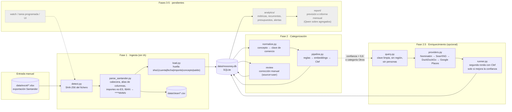
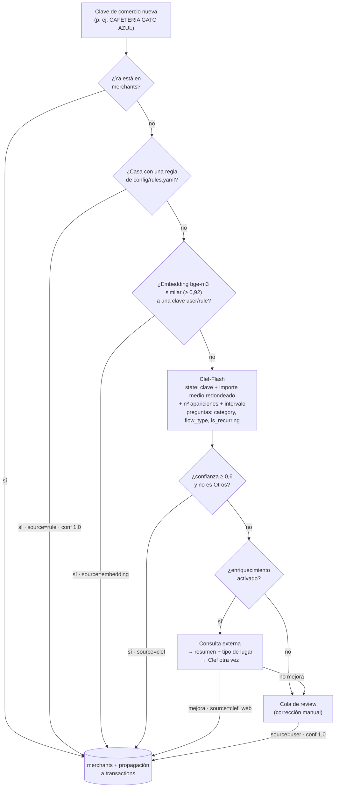
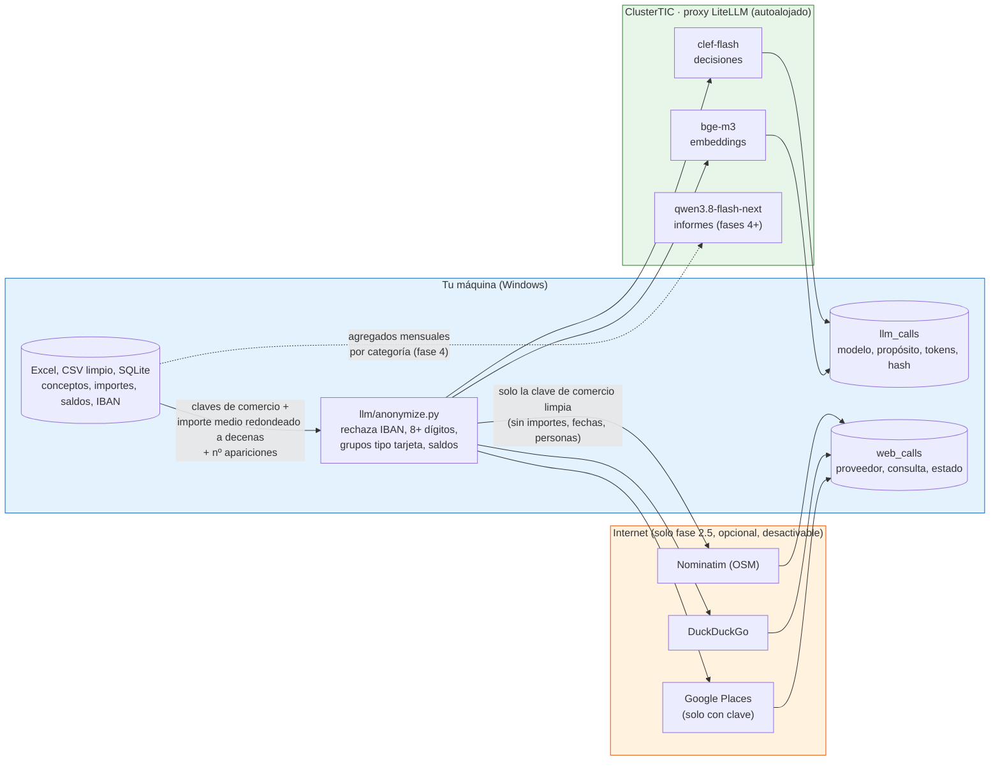
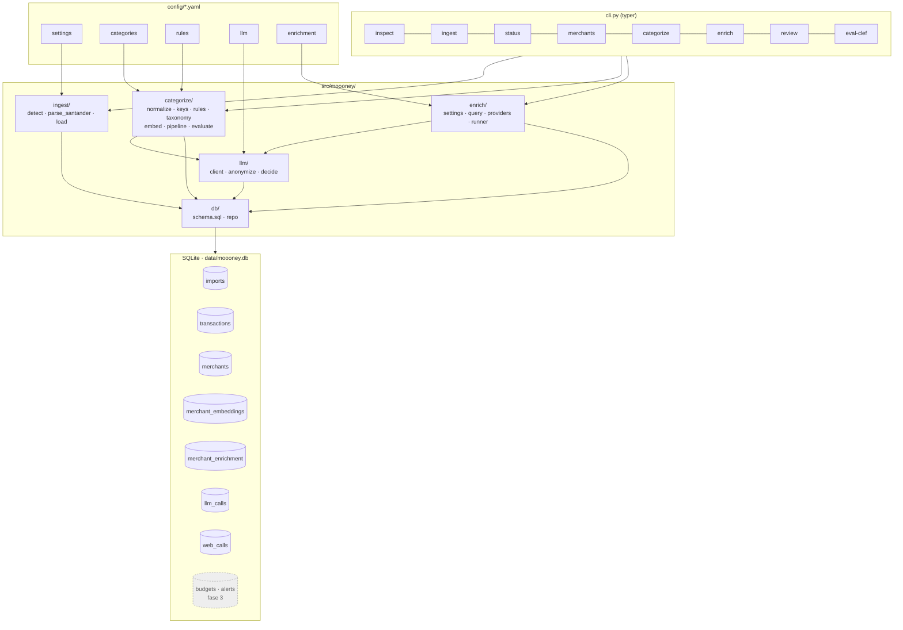

# Arquitectura de moooney

Diagramas en Mermaid: GitHub los renderiza al abrir este fichero. Para verlos en local, cualquier
editor con vista previa de Markdown y Mermaid (VS Code con la extensión "Markdown Preview Mermaid
Support") o [mermaid.live](https://mermaid.live).

## 1. Flujo de datos de extremo a extremo

Qué entra, por qué etapas pasa y dónde se guarda cada cosa. Las etapas en gris son las fases
pendientes (3, 4 y 5).

## 2. Cascada de categorización

Cada **clave de comercio** (no cada transacción) baja por esta cascada una sola vez. El
resultado se guarda en la tabla `merchants` con su fuente, y la fuente manda al recategorizar:
`user > rule > embedding > clef_web > clef > llm`.

## 3. Fronteras de privacidad: qué sale de dónde

El principio del proyecto es que los datos bancarios no salen de la máquina. Este diagrama
marca las tres zonas y exactamente qué cruza cada frontera.

Lo que **nunca** cruza ninguna frontera: el IBAN completo, saldos, importes exactos, fechas de
movimientos individuales, conceptos crudos y nombres de personas. `MOOONEY_OFFLINE=1` bloquea
las dos fronteras a la vez.

## 4. Módulos y tablas

